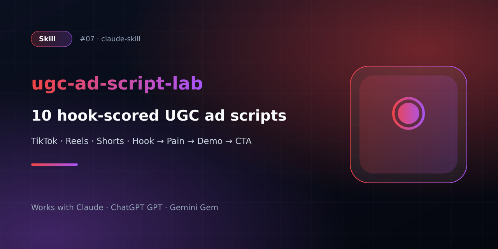

<p align="center"><a href="https://cloudskillhub.com"></a></p>

# ugc-ad-script-lab

🌐 **Website:** [cloudskillhub.com](https://cloudskillhub.com) · 📦 **All skills:** [skillhub](https://github.com/jahirulofficial0/skillhub)

From one product brief, get 10 hook-scored, shoot-ready UGC ad scripts for TikTok, Reels and Shorts — hook, pain, demo beat, CTA — ranked by hook strength, with phone-filming notes.

**Works with:** Claude (Code, Desktop, claude.ai) · ChatGPT custom GPT · Gemini Gem

## Install

### Claude Code — this skill only
```
/plugin marketplace add jahirulofficial0/skillhub
/plugin install ugc-ad-script-lab@skillhub
```
Or directly from this repo: copy `skills/ugc-ad-script-lab/` into `~/.claude/skills/`.

### All 10 skills at once
See **[skillhub](https://github.com/jahirulofficial0/skillhub)** — one marketplace, or one MCP server that serves all 10 skills.

### claude.ai
Download `skills/ugc-ad-script-lab/` as a ZIP → **Settings → Capabilities → Skills → Upload skill**.

### ChatGPT / Gemini
- ChatGPT GPT: [`prompts/chatgpt-gpt.md`](prompts/chatgpt-gpt.md)
- Gemini Gem: [`prompts/gemini-gem.md`](prompts/gemini-gem.md)

## Usage
Just describe the task — the skill activates when relevant. Example:

> Product: smart Wi-Fi CCTV camera, AED 199, night vision, phone alerts. Audience: small shop owners in UAE. 30 s Reels.

See [`examples/`](examples/) for a full input → output sample.

## What you get
```
## Ranking
| Rank | Angle | Hook | Hook score |
## Script 1 — <angle> (30 s)
| Time | Visual | Spoken | On-screen text |
Filming notes: …
## Compliance Notes
```

## Repository layout
```
.claude-plugin/plugin.json   Claude Code plugin manifest
skills/ugc-ad-script-lab/SKILL.md       The skill
prompts/                     ChatGPT GPT and Gemini Gem versions
examples/                    Sample input and output
assets/banner.png            Social preview image
```

## Author
**Jahirul** — [cloudskillhub.com](https://cloudskillhub.com) · [github.com/jahirulofficial0](https://github.com/jahirulofficial0)

## License
MIT — see [LICENSE](LICENSE).
